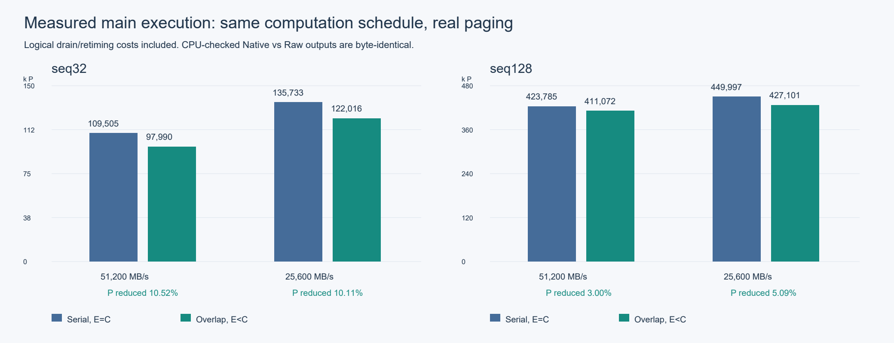
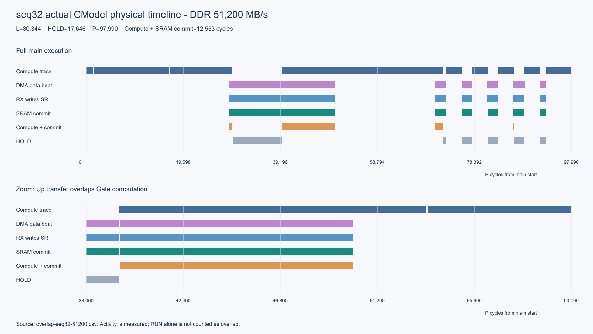

# 公共屏障、暂停恢复与计算/分页重叠：验收记录

验证日期：2026-10-27。公共屏障、统一暂停/恢复及 DDR → C2C → MEM → SRAM 与计算的重叠，已在当前 lpu32 目标的 seq32、seq128 完整单层 decoder 上通过实际执行和数值验证。两个长度、两档带宽的重叠程序及同调度串行对照共八组均通过；seq128 不再只有编译验证。没有实现任意流水线位置抢占。

本次修改基于 SOFTWARE main `7ba85e7`、CMODEL main `bc84188`，复用原 main worktree，未提交或推送。历史 v37 串行结果保留在 [原验收记录](common_barrier_validation.zh-CN.md)；当前结果以本文为准。格式、状态机与边沿的详细定义见 [v38 协议](common_barrier_binary_v38.zh-CN.md)。

## 完成情况

| 部分 | 当前实现及验证 |
| --- | --- |
| 公共屏障 | 每任务每芯片一张有限表，1024 项；当前/下一项缓存；C 前优先检查，早到事件不提前跳过 C，同 C 依赖聚合 all-of；损坏、溢出、遗漏关联、错过 C 显式失败 |
| 暂停/恢复 | P 每拍推进，L 仅在计算使能时推进；Native PC/NOP/循环、Macro Context/地址/解码缓冲保持；已发取指响应按预留 credit 捕获；真实有限 PRIME 保留 |
| 实际完成 | MEM 带 generation/launch 控制侧带，C2C 端口显式标记来源；所有目标 bank/tile 的实际 SRAM 提交计数达到目标且搬运尾部交还资源后才通知实例完成；不依赖全片计算 idle |
| 计算与搬运重叠 | E 允许提前启动，C 才等待；页级按序搬运，保持有限 FIFO/背压和共享 MEM 仲裁；真正 DMA beat、RX 写 SR、SRAM commit 均与计算重叠 |
| 编译与最终链接 | Gate、Up、各 Down 页分别设安全候选；链接器依据最终计算指令的 MEM/SR 占用与 SRAM 生存期选择 E、lane；镜像装载重新复核；重排分页时重新链接 |
| 文件与兼容 | v38 增加 E、重叠标识及能力 ABI；BARR v1、packed-v1 不变；四条读取路径及 v36/v37 兼容通过；不支持目标拒绝 |

同一分页依赖的计算 WAIT/SYNC 映射到公共表；实际 DMA/RX launch、完成 SYNC、MEM 同步写和 KV 同步读保留。公共路径不再叠加旧 phase_offset，Raw Macro 不静默回退 FU3D。

```text
INIT：解析/最终链接/重定位 → generation、实例状态、Barrier RAM、i-MEM
PRIME：真实有限取指与解码前端准备，L 不前进
RUN：L 达到 E，且前序搬运已提交/资源已交还 → 启动本页，继续计算
L=C：先检查计算已安全排空，再检查本屏障所有成员
      ready → 消费当前项，缓存后续项，本 dispatch 从 C 发射
      未 ready → HOLD，L=C；DDR/RX/MEM commit、事件、P 继续
HOLD：最后所需 SRAM 提交 + 搬运尾部排空 → 锁存 ready
      下一 dispatch 边沿消费屏障，从 C 恢复
```

Context 非空可以暂停，已在 SRAM、ACC 等稳定状态中的数据保持。此前计算的瞬态流水必须在到 C 前排空；带明确来源的搬运允许仍在途。未证明的安全点、活跃地址覆盖、SR 冲突或依赖 C 后计算的完成事件均拒绝。

## 数值与性能结果

执行对象是 `compiler/examples/smollm2_135m_decoder_layer` 的完整 attention + FFN 单层程序，含 KV 通路，采用 harness 的非零模式权重。先执行有 CPU 参考校验的原生基线，再由 ModelSession 执行真实 Raw Macro/Native 混合分页程序，比较最终输出；没有用离线删 SYNC 或队列回放替代分页验收。以下结果不代表真实预训练权重、多层模型或 Qwen3.5 的数值验收。

- seq32：18,432 个 BF16 输出与原生基线逐字节一致，相对 CPU 最大绝对误差 0.03125。
- seq128：73,728 个 BF16 输出与原生基线逐字节一致，相对 CPU 最大绝对误差 0.0625。
- 两者 attention residual 最大误差 0、RMS2 最大误差 0.015625；FFN hidden 对硬件参考及东西副本误差均为 0。沿用原数值门限，未放宽。

P 为主执行段物理周期，满足 **P=L+HOLD**；L 包括显式重调度/排空及末尾 drain 64。带宽单位 MB/s。串行对照保留完全相同的计算调度与七个安全点，只在测试 harness 中关闭提前搬运，使 E=C，因此能单独衡量重叠收益。

| 长度 | DDR | L | 串行 HOLD | 重叠 HOLD | 串行 P | 重叠 P | P 减少 |
| --- | ---: | ---: | ---: | ---: | ---: | ---: | ---: |
| seq32 | 51,200 | 80,344 | 29,161 | 17,646 | 109,505 | 97,990 | 10.52% |
| seq32 | 25,600 | 80,344 | 55,389 | 41,672 | 135,733 | 122,016 | 10.11% |
| seq128 | 51,200 | 394,500 | 29,285 | 16,572 | 423,785 | 411,072 | 3.00% |
| seq128 | 25,600 | 394,500 | 55,497 | 32,601 | 449,997 | 427,101 | 5.09% |



新增调度成本合计 **372 L**：Up 边界 124，后续四个 Down 页各 62。与既有两个 62 拍窗口合计为 496 L，已经包含在表中，没有扣掉后再报加速。Up 的 124 是写回尾部与重调度总成本，最后 62 拍才是要求无计算发射的排空窗口。Down 的间隔在 ACC 槽串行复用安排之后插入，避免被 seq128 的第二槽计算吸收。

| 长度 | 原串行调度 L | 原串行 P（51,200 / 25,600） | 新重叠 P（51,200 / 25,600） | 含新增调度成本的 P 减少 |
| --- | ---: | ---: | ---: | ---: |
| seq32 | 79,972 | 109,165 / 135,500 | 97,990 / 122,016 | 10.24% / 9.95% |
| seq128 | 394,128 | 423,360 / 449,670 | 411,072 / 427,101 | 2.90% / 5.02% |

seq32 原串行数据取自此前 main 实测；seq128 原先未执行验收，本轮通过目标 `common_transport_overlap_version=0` 重建既有两屏障串行调度，并实际运行两档带宽，均通过数值检查。它是当前实现上的旧调度对照，不冒称历史版本二进制的既有实测。

启动权重等待另计：51,200 下 1,849 P，25,600 下 3,375 P；真实前端 PRIME 为 seq32 80、seq128 104 拍。上表不含完整 INIT、i-MEM DDR 装载、输入/输出及全部 bootstrap 成本，也不是 CModel 宿主运行时间或端到端整模型时延。这里的总收益指相对原串行调度、计入新增计算调度成本后的主执行收益。

## 重叠的真实通路证据

统计以每个物理 tick 的实际状态为准：计算有在途 FU/SR 活动，DMA 有 beat、RX 有 C2C 端口写入 SR、MEM 有实际 `write_segment`，才计入对应交集。RUN 空转不计为计算重叠。完成追踪和来源标记不依赖 trace 是否开启或 producer 调试名称。

| 长度 | DDR | 计算 ∩ DMA beat（P） | 计算 ∩ RX 写 SR（P） | 计算 ∩ SRAM commit（P） |
| --- | ---: | ---: | ---: | ---: |
| seq32 | 51,200 | 10,521 | 12,577 | 12,553 |
| seq32 | 25,600 | 7,329 | 10,631 | 10,614 |
| seq128 | 51,200 | 11,195 | 13,546 | 13,517 |
| seq128 | 25,600 | 11,206 | 16,598 | 16,574 |

同调度串行四组的三个交集均为 0。所有组均有 7 个执行期 page-use、8 次总预取（含启动）、2,801,664 字节预取量、104 条 MEM 同步写控制、56 条 KV 同步读控制、82,944 次同步 FU 写和 331,776 次 tile segment 提交。三个交集可能互相重叠，不能相加充当隐藏时长。



图片由真实执行 CSV 绘制。四个重叠运行的原始 CSV 为 `overlap-seq{32,128}-{51200,25600}.csv`，可在工程 `tools/pipeline_viewer/index.html` 中加载；图中 `Paging.Activity` 来自运行时，`ICU.PageReadyWait` 标出 HOLD。CSV 中还保留原有 DMA/RX、MEM.C2CWrite 和计算队列轨迹。原始大文件保留在下文证据目录，没有复制为仓库内的大型测试数据。

## 最终屏障及逻辑序列一致性

| 页实例 | seq32 E | seq32 C | seq128 E | seq128 C |
| --- | ---: | ---: | ---: | ---: |
| Gate | 28,823 | 29,556 | 135,499 | 136,448 |
| Up | 28,823 | 43,560 | 135,499 | 192,113 |
| Down 0 | 60,515 | 62,216 | 259,903 | 266,212 |
| Down 1 | 65,352 | 65,508 | 290,670 | 290,923 |
| Down 2 | 68,556 | 68,712 | 315,200 | 315,453 |
| Down 3 | 71,760 | 71,916 | 339,730 | 339,983 |
| Down 4 | 74,964 | 75,120 | 364,260 | 364,513 |

E 是最早允许启动的逻辑周期；仍须前序页提交并交还资源，所以 Gate/Up 的 E 相同不表示同时实际启动。七页均有 E<C。每项事件 ID 为 196608+i，launch ID 为 65536+i，分别关联 page-use i；同 C all-of 在小型运行时测试中覆盖。

同一未链接 Raw 输入在两档带宽下生成完全相同的 linked 文件：

- seq32 SHA256：`3A31EF1EFFD17FD677EF1645AC80D679CE654D247B6DBCD19570949E6FCAF621`。
- seq128 SHA256：`C00D749FB25C2F001C1B0C98309E1FCA2586F6D662B36D37320BE279880A056D`。

通过 [实际 CSV 比较工具](../runtime/tests/runtime/compare_paging_overlap_traces.py) 扣除主执行内的 HOLD，只比较实际 MEM/MXM/VXM/SXM 计算记录（MEM.C2CWrite 是搬运记录），两个长度的逻辑轨迹分别完全相同。seq32 比较 663,525、seq128 比较 2,509,740 个带资源/指令描述的活动拍；这些计数不是逻辑总周期或唯一指令条数。CSV 不含每条指令的完整编码，因此以 linked 文件字节一致证明内容一致，以实际轨迹比较证明执行时序未因带宽而改变。

对应报告见 [seq32](evidence/common_transport_overlap/seq32-logical-trace.json)、[seq128](evidence/common_transport_overlap/seq128-logical-trace.json)。最终显式 C2C 端口来源标记的源码再次运行 seq32/51,200，linked SHA、逻辑轨迹、数值及所有性能统计均与前述结果一致。

## 存储开销

| 项目（字节） | seq32 | seq128 |
| --- | ---: | ---: |
| 计算 i-MEM（MacroPacked + Native） | 92,992 | 251,320 |
| Native 搬运控制（含 C2C、MEM） | 9,144 | 9,144 |
| i-MEM 合计 | 102,136 | 260,464 |
| 有效 Barrier RAM（7×8） | 56 | 56 |
| i-MEM + 有效 Barrier RAM | 102,192 | 260,520 |
| BARR 文件块（含 16 字节头） | 72 | 72 |
| 事件成员关联文件区 | 84 | 84 |
| page-use launch ID + E 元数据 | 56 | 56 |
| 完整 linked `.ftlpu` | 152,893 | 355,424 |

目标配置的 Barrier RAM 为 8,192 字节，当前/下一项缓存另为 16 字节；有效使用量不等于配置容量。事件 ready 状态、generation、MEM 提交 scoreboard 和 owner 关联也有有限存储，不能用 CModel STL 宿主对象大小冒充 RTL 综合面积。表中不含权重 payload、数据 SRAM 和硬件 Context RAM。详细分栏见 evidence 中两个 inspector 文本；旧 aggregate i-MEM 行不能替代包含独立 transport 区的协议总量。seq32 相比原串行计算码流和 transport 字节不变，有效表增加 40 字节，容器增加 575 字节。

## 回归及拒绝路径

- SOFTWARE 最终定向回归 **16/16 通过，62.17 秒**；含容器、公共运行时、Macro bitstream、FU3D lowering、ModelSession C2C、旧 page-ready、MEM trace、模型包、ping-pong、issue inspector、weight planner、RoPE/FFN/elementwise、seq128 双路径完整编译、真实 Raw CLI。
- CMODEL 最终定向回归 **10/10 通过，4.61 秒**；含 MEM array、旧/公共屏障、Macro schedule、Raw decoder、MEM 3D、VXM/SXM 2D、双芯片 C2C、DMA/DDR。
- 容器覆盖空表/多屏障四读取路径、截断/坏字段、无效事件/实例/launch、不一致 E、E>C、能力不支持、周期溢出、有限容量及真实 v36/v37 fixture。最终 reader 另成功读取此前非空 v37 Raw decoder。
- 前端覆盖多活动 Context、单 Macro 跨屏障、32 个解码阶段、未返回的 Native/Macro fetch、连续屏障、零等待、早到/晚到/重复/旧 generation、all-of 与同页重装。
- 小型 Native/Macro 真实搬运测试固定 L=516；串行早/晚 P=579/630，重叠早/晚 P=516/677；延迟 MEM 接收且 FIFO 深度 2 时 P=692。验证在途搬运进入 HOLD、实际背压和无提前完成，不将这个人为延迟测试作为性能加速证据。
- 实际 SRAM 提交跟踪在关闭调试 trace、无关计算持续活跃时仍能完成；最后 tile/提交不足、错误实例、10 类损坏的搬运关联、共享 MEM/SR 冲突、活跃写域覆盖、错误释放顺序与未来计算依赖均明确拒绝。

本轮同时修正了 seq128 测试读取 packed 激活时遗漏 token/32、误用 token-block 总数的参考寻址问题，读取公式与 binding 的真实存储形状一致；未修改数值门限。Macro bitstream 测试把较大的 ICU 测试对象移到 heap，解决 Windows 栈溢出，不改变硬件资源容量。

## 复现与证据位置

固定本次工作区：

```text
SOFTWARE=C:/Users/Jiang_Hua/.codex/worktrees/port-seq128-correctness/FTLPU-SOFTWARE
CMODEL=E:/Fudan_University/internship/timesintelli/LPU/work/FTLPU-CMODEL/out/main-mature-macro
BUILD=E:/Fudan_University/internship/timesintelli/LPU/work/FTLPU-SOFTWARE/out/main-common-barrier-ninja
OUT=E:/Fudan_University/internship/timesintelli/LPU/work/FTLPU-SOFTWARE/out/main-common-barrier-e2e
```

以下 PowerShell 示例先设置上述四个路径变量。按现有 VS C++ 环境增量构建 `ftlpu_compile`、`ftlpu_binary_inspect`、`compiled_smollm2_common_barrier_decoder_test`、`compiled_smollm2_common_barrier_seq128_decoder_test`。

```powershell
$seq = 32 # 再以 128 运行
$inputFile = "$SOFTWARE/compiler/examples/smollm2_135m_decoder_layer/decoder_layer_seq${seq}.stablehlo.mlir"
$argsCommon = @('--input', $inputFile, '--input-stage', 'stablehlo',
  '--target-config', "$CMODEL/config/ftlpu-lpu32.json", '--weight-bank', '1',
  '--kv-cache-capacity', '256', '--mxm-execution', 'vector',
  '--projection-rope-overlap', 'off', '--ffn-schedule', 'tail')
& "$BUILD/compiler/ftlpu-compile.exe" @argsCommon --icu-compression none --output "$OUT/overlap-seq${seq}-native.ftlpu"
& "$BUILD/compiler/ftlpu-compile.exe" @argsCommon --icu-compression raw-macro --output "$OUT/overlap-seq${seq}-raw.ftlpu"
$runner = if ($seq -eq 32) { 'compiled_smollm2_common_barrier_decoder_test' } else { 'compiled_smollm2_common_barrier_seq128_decoder_test' }
Remove-Item Env:FTLPU_SKIP_QWEN_NUMERIC_CHECK,Env:FTLPU_TRACE_ONLY,Env:FTLPU_TEST_SERIAL_PAGING,Env:FTLPU_QWEN_HIDDEN_CHECKPOINT_ONLY -ErrorAction SilentlyContinue
$env:FTLPU_DDR_BANDWIDTH_MBPS = '51200' # 第二档改为 25600，复用相同输入
$tag = "overlap-seq${seq}-$env:FTLPU_DDR_BANDWIDTH_MBPS"
$env:FTLPU_QWEN_C2C_PIPELINE_CSV = "$OUT/$tag.csv"
$env:FTLPU_QWEN_C2C_LINKED_BINARY = "$OUT/$tag-linked.ftlpu"
& "$BUILD/runtime/$runner.exe" "$OUT/overlap-seq${seq}-native.ftlpu" "$OUT/overlap-seq${seq}-raw.ftlpu" > "$OUT/$tag.log" 2>&1
# 同调度串行对照：设置 FTLPU_TEST_SERIAL_PAGING=1，使用带 -serial 的新输出名再运行。
python "$SOFTWARE/runtime/tests/runtime/compare_paging_overlap_traces.py" "$OUT/overlap-seq${seq}-51200.csv" "$OUT/overlap-seq${seq}-25600.csv"
```

串行模式仅为测试对照开关，生产链接器不依赖该环境变量。`common_overlap_link_test` 只作轻量最终链接/装载预检，不能代替上述实际执行。

小型日志、inspector、机器可读结果及哈希已归档到 [evidence/common_transport_overlap](evidence/common_transport_overlap/results.json)；图在 `docs/images/common_transport_overlap_*.png/.svg`。原始 CSV、linked 文件、模式权重及构建日志仍在 OUT；`overlap-final-regressions.log`、`overlap-final-core.log`、`overlap-final-seq32-51200.log` 是最后复验。CMODEL 日志为其 main worktree 的 `out/overlap-final-regressions.log`。

## 剩余限制

1. 仅支持可证明的暂停点；不透明抢占任意流水线位置。新增候选必须在到 C 前排空计算瞬态，稳定存储可以保留。
2. 资源证明保守预留整个目标 MEM bank 发射口及选中 West SR 编号的完整传播路径，包含两半球；静态分析有 800 万条 issue 上限。可能拒绝可用更细粒度仲裁实现的组合，E=C 回退需记录原因。复杂间接/gather/scatter 或未支持的 Native 控制域拒绝。
3. 页级按序搬运，不支持乱序页调度、额外 staging、跨 invocation lookahead 或跨任务同时执行；没有新增端口、SR 或 DMA FIFO 容量。控制表预加载，不支持运行时流式 refill。
4. 本次实际验收范围是 lpu32、非零模式权重、单层 SmolLM2 结构、seq32/seq128、两档 DDR。没有据此声称 Qwen3.5、真实预训练模型、多层、多芯片端到端或所有目标配置完成验收；定向回归也不是全仓库全量测试。
5. 新增控制侧带、有限提交计数和显式来源已经在 CModel 中实现；RTL 综合面积、真实芯片握手/带宽及功耗尚未验证。事件状态与 scoreboard 的硬件面积不能从上述文件大小直接推出。
