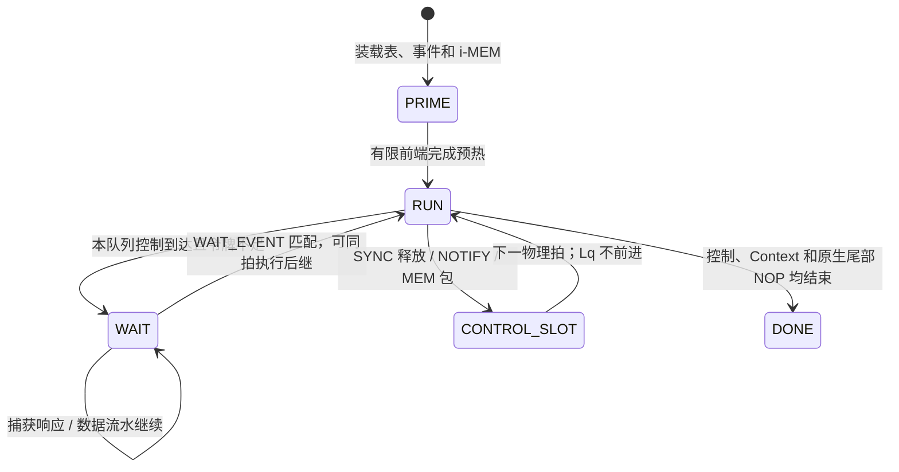

# v39：按队列执行的公共伪控制表

当前 main 的链式 VXM、定时装载支持范围及集成复验见 [main 集成记录](queue_control_main_integration.zh-CN.md)。

本文描述 `queue_control_version=1`。v37/v38 的 BARR 仍是全局计算逻辑周期屏障，读取时不转换、不重新解释。新路径使用 QCTL；MEM/MXM 的 packed-v1 编码不变。验证结果和复现命令见 [queue_control_v39_validation.zh-CN.md](queue_control_v39_validation.zh-CN.md)。

## 执行模型

一任务、一芯片共用事件实例状态和控制表；控制表按队列装载到独立有限分区。每个 Macro 队列有自己的执行坐标 `Lq` 和控制游标。物理周期 `P` 始终推进，已经发出的 MEM/MXM/SXM/VXM 流水、DDR、C2C 和完成反馈继续运行。其他队列不因当前队列等待而停机。

Native 控制字和伪控制共同调用 `DistributedIcuQueue::execute_synchronization()`。Native 队列保留真实指令及取指行为。只有转为 Raw Macro 的队列从指令流外置控制；Native 目录项只是绑定校验，不能再注入一次。

| 操作 | 本队列行为 | `Lq` | 通知 |
|---|---|---|---|
| WAIT_EVENT，未匹配 | 停止后续发射，保持 Context 和前端执行状态 | 保持 | 等待匹配标签 |
| WAIT_EVENT，已匹配 | 消费控制；缓存中后继可在同拍继续 | 不为 WAIT 加拍 | 消费一个匹配令牌 |
| SYNC，未匹配 | 等待 | 保持 | 无标签令牌 |
| SYNC，已匹配 | 本拍释放，下一拍处理后继 | 保持 | 消费一个无标签令牌 |
| NOTIFY | 占用本拍，沿原有 ICU 路径传播 | 保持 | 每次执行都产生通知，不做分页去重 |
| MEM_PACKET | 交给原生同步包执行器，遵守接收、reservation 和退休顺序 | 保持 | 保留 RX 到 MEM 的原生握手 |
| 普通计算/计算空拍 | 先检查控制，再发射已有 Context，再处理前端 | 加一 | 无 |

控制检查位于 `issue_active_macro()` 之前。多个活跃 Context、已预解码描述符、地址和循环状态可以跨越等待。已发出的取指响应继续捕获；请求发出时预留 reservoir/cache 空间，等待不能使响应覆盖旧数据或消费两次。

同一 `Lq` 的连续控制保留顺序，不合并。连续 ready WAIT 可同拍消费，但只能消费已经到达有限缓存的记录；缓存不足显式报错，不暗中插空拍。原生尾部 NOP 是程序的一部分，分区 `end_cycle` 保留其独占结束坐标；它不是最后一次 FU 发射的周期。

## 有限前端和任务事件

装载返回前先完成 Native 队列初始化，再允许外部事件投递，避免第一物理拍前已到达的令牌被 lazy launch 清除。

当前 lpu32 配置：每队列控制 RAM 深度 256，预取缓存 8，读延迟 2 个物理周期，每拍一个读请求。PRIME 使用真实 Macro 解码和控制 RAM 访问，不使用无限缓存或零延迟解码。读取控制表不会占用其他队列的控制端口。

完成状态由 `generation + page_use_index` 标识，一次页面重新装入对应另一个实例。每任务最多 65,535 个完成事件/实例；重复提交幂等，旧 generation 无效，未来 generation 和未知实例报错。页事件是所列实例的 all-of。原生通知令牌与分页实例完成状态分开，合法的多次 NOTIFY 不会被合并。

QCTL 的 `External` 事件声明由原生/宿主投递的标签，包含合法的原生标签 0；`PageCommit` 事件必须关联具体页实例及真实 DMA/RX/MEM 包。PageCommit 的标签非零。

## MEM 端口、提交与释放相位

每个 Raw MEM 队列的 `MEM_PACKET(ordinal)` 对应独立 Native transport store 中的一个同步包。只有到达这个队列边界，包才能取得 MEM 发射口。计算 Context 可以保留，但该队列不能越过包继续发射。包的最后发射、reservation 结束/退休、末 tile 的 SRAM 提交分别观察；退休不等同于页面 ready。

实际写入携带来源、generation 和搬运实例关联。各 bank 的目标写入量为向量数乘 tile 数；全部实际提交后才标记实例完成。这些计数不依赖 trace 开关，也不等待无关计算或全片 idle。RX 保留已有有限 FIFO 和 MEM 接收背压。共享端口竞争及 SR 冲突仍由既有执行检查拒绝。

事件 all-of 完成后，不立即广播给所有队列。最终链接保存原生参与者和 `phase_offset`、激活生产者标记。`release_queue_phase()` 是 Native 和 QCTL 共用的物理释放算法：先做原生启动参与者汇合，再按相位检查对应队列确已到 WAIT，一次物理边沿释放一个相位组。后续相位可以依赖已经启动的计算，不能被错误纳入全局启动汇合。

装载还从 DMA/RX/MEM 包顺序和 PageCommit WAIT 建立实例依赖图，拒绝等待自身未来 MEM 包及跨队列逆序形成的死锁环。该图只使用真实控制顺序，不把独立的 Lq 当成公共时间。

QCTL 路径在物理 tick 的提交捕获后推进释放。下一拍按原生令牌可见规则执行。`phase_offset` 描述队列间生产/消费相位，不作为全局冻结后的额外补偿。

原生链接器中对插入控制边界的源坐标记账，与 WAIT 的硬件执行拍数不是同一概念。现有排布和释放相位一起复用；不能依据旧的“WAIT 必占一拍”注释单独删除 `cursor` 调整。定向原生/伪控制测试明确验证 ready WAIT 同拍继续、SYNC 占拍。

## 编译与最终链接

1. 支持新能力的 direct Raw 编译路径先生成 Native 控制及紧凑 FU 域。
2. 建立独立于压缩方式的队列控制边界，再降低 MEM/MXM 为 packed-v1；不按 Macro 描述符或 bit offset 定位控制。
3. 运行时按实际布局和搬运计划运行既有 Native 分页链接器。必要的 MEM 同步包、DMA/RX 启动、KV 控制和释放相位保留。
4. 最终编码将同一 Native 同步计划映射为 QCTL；地址和 scale relocation 跟随计算或 transport store 的实际位置。
5. 从最终 Native 队列重新计算结束范围，完成 QCTL 校验，再装载事件状态、控制分区和各 i-MEM。

新能力路径不插入旧全局 BARR 专用的 C 前排空窗口和 Up/Down 调度空窗。原生分页计划所需的空拍、流水依赖和资源安排仍然保留。旧协议继续使用原有检查。失败显式报错，不回退 FU3D 或旧全局屏障。

`QLNK` 保存重新链接所需的紧凑 Native FU 域和 relocation；不是逐周期展开队列，也不是可执行回退。候选镜像的 `required` 标记禁止直接送入 CModelRuntime。运行时重排使用配方重新建立同一 Native 计划、QCTL 和最终镜像。当前配方的容器空间开销较大，必须与 i-MEM 压缩量分开报告。

## 文件格式与 ABI

新 writer 使用容器 v39；旧加载器拒绝版本号。目标 ABI 增加 `queue_control_version/capacity/cache_depth/read_latency/read_ports`，能力不匹配拒绝装载。packed-v1 和 BARR encoding 1 不变。

布局为现有头/ABI/硬件/元数据、BARR、QCTL、QLNK、计算队列、transport 队列、relocation。即使没有任何屏障/控制/配方，三个块也都有明确头。所有新增字段显式小端写入，不序列化 C++ 结构体填充。

QCTL 块头 16 字节：

| 字段 | 字节 |
|---|---:|
| `QCTL` | 4 |
| encoding=1 | 2 |
| record_bytes=24 | 2 |
| partition_count | 4 |
| event_count | 4 |

每个分区先写 12 字节目录：`kind:u16, index:u16, count:u32, end_cycle:u32`，紧接其记录。每条记录 24 字节：`Lq:u32, opcode:u16, flags:u16, operand:u32, source_command:u32, release_group:u32, phase_offset:u32`。flags bit0 是 Native 绑定，bit1 是激活生产者，其余必须零。MEM_PACKET 的 opcode=8 只用于表，不冒充原生 ISA 控制字。

分区之后是事件：`event_id:u32, source:u16, reserved:u16=0, instance_count:u32`，再写 `instance_count` 个 `u32` 页实例索引。相同分区按位置、源控制顺序排序；相同位置的控制不去重。不同分区独立读取。

QLNK 块头 24 字节：`QLNK, version:u16=1, flags:u16(required bit0), queue_count:u32, address_count:u32, scale_count:u32, reserved:u32=0`。随后每队列 `kind:u16,index:u16,record_count:u32` 和既有 CompactTagged 紧凑 Native 记录；地址 relocation 16 字节，scale relocation 18 字节，逐字段小端。配方不能包含已经折叠的 Macro 或 transport store；数量和 relocation 范围均检查。

stream、span、两种 metadata-only reader 都识别新块并校验。v39 metadata-only 目前通过完整解析完成 Native 绑定验证，之后清除执行队列；它不是只读文件头的低内存扫描。v37/v38 沿用旧布局、ABI 迁移和执行语义。

## 接口、统计与适用边界

- 编码/重链接：`externalize_native_queue_controls()`、`native_queue_link_input()`。
- 装载和查询：`CModelRuntime::load/load_file`、`queue_execution_progress()`、`queue_release_complete()`。
- 通知：ICU 原生 `notify_tagged`/广播；分页 `notify_common_page_commit(generation,instance)` 在 QCTL 下进入独立实例完成状态。
- 逐队列统计记录等待拍、结束物理拍、发射数和队列坐标；Raw 坐标是 `Lq`，Native 仍是原有队列执行坐标。等待可以重叠，不能相加得到全片总等待。
- 主执行 `P`、PRIME、前置搬运和后置 KV/输出搬运分开报告。`queue_execution_ticks` 只是运行时主循环计数，不是公共计算逻辑时间。

这是对已验证 Native 分页程序的控制存储方式替换。它不提供任意流水线抢占，也不证明任意手工插入控制的程序安全。支持当前 MEM/MXM coarse-domain lowering；不支持的 native4/重复控制/其他粗粒度包组合继续明确拒绝。数据通路和 i-MEM、Context、DDB、SR、DMA FIFO 资源没有扩大。

逐拍等价以相同事件序列、同一 Native 布局/调度/搬运计划和真实前端供给为条件。控制缓存或解码供给不足会报错，不能插入隐藏空拍后宣称等价。单元测试不能替代真实 decoder；验证文档单独列出已执行案例和未覆盖项。
